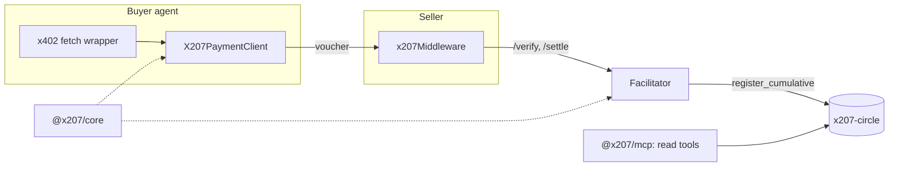

# x207 SDK

TypeScript packages that let an x402 agent pay and sell on a credit circle: the x402 `batch-settlement` binding on the network `x207:<circleId>`, plus a reference facilitator, an MCP server and test vectors. Part of [x207](https://github.com/x207-labs/x207).

## Its role in x207

The SDK is how agents meet the [contract](https://github.com/x207-labs/contracts) without knowing NEAR. A buyer wraps `fetch` once and pays with signed vouchers; a seller adds one middleware and its `402` answer offers the voucher entry next to `exact`; the facilitator verifies vouchers and registers them on chain. `spec/` holds the voucher format and test vectors that the TypeScript and Rust CI share.

| Folder | Package | Contents |
| --- | --- | --- |
| `packages/core/` | `@x207/core` (0.0.1 on npm) | Voucher types and signing, client for the `x207-circle` contract, NEP-297 event parser, `onboardMember` |
| `packages/scheme/` | `@x207/scheme` (0.0.1 on npm) | x402 binding per role: `client/`, `server/`, `facilitator/` |
| `packages/mcp/` | `@x207/mcp` (0.0.2 on npm, bin `x207-mcp`) | MCP server: read tools by default, signs nothing |
| `apps/facilitator/` | `@x207/facilitator` | Reference facilitator: `/verify`, `/settle`, `/supported` |
| `spec/` | | `scheme_batch_settlement_x207.md` and `test-vectors/` |
| `examples/` | | `buyer`, `seller`, `mcp-paid-tool`, `python-buyer` |



## Try it

Ask an AI client about the live testnet circle through the MCP server, with no key (needs Node 22.22.2 or newer):

```bash
X207_CIRCLE_CONTRACT=x207-v013.testnet X207_CIRCLE_ID=agents-main \
X207_BACKEND_URL=https://x207-backend-production.up.railway.app npx -y @x207/mcp
```

This starts a stdio server for an MCP client, so it waits for input. Configuration for Claude Desktop and Cursor: [docs in the umbrella](https://github.com/x207-labs/x207/blob/main/docs/mcp.md). To pay as a buyer:

```bash
npm install @x207/core @x207/scheme @x402/fetch
```

The snippet is ESM (top-level `await`): put `"type": "module"` in your `package.json`, or save it as a `.mts` file.

```ts
import { wrapFetchWithPayment } from "@x402/fetch";
import { X207PaymentClient, headroomFromRpc } from "@x207/scheme";

const secretKey = process.env.X207_VOUCHER_KEY as `ed25519:${string}`; // the voucher key, see below
const client = new X207PaymentClient({ payer: "agent.near", secretKey, headroom: headroomFromRpc({}) });
const paidFetch = wrapFetchWithPayment(fetch, client);
const response = await paidFetch("https://seller.example/api/summarize");
```

`secretKey` is the voucher key: one ed25519 key used only for vouchers, never a NEAR access key ([Voucher key security](docs/voucher-key-security.md)). `X207PaymentClient` registers `x207:*` and falls back to the other entry of the `402` answer (normally `exact`) when headroom runs out. A 200 response carries the header `PAYMENT-RESPONSE`; `extensions.x207.registration` is `pending`, `retrying` or `registered`.

Joining a circle (`onboardMember`: voucher key, `join`, stake, wait for `active`) is in the [quickstart](https://github.com/x207-labs/x207/blob/main/docs/quickstart.md). Selling: [docs/seller-quickstart.md](docs/seller-quickstart.md). Full tested examples: [`examples/buyer`](examples/buyer), [`examples/seller`](examples/seller).

## Develop and test

Needs Node ≥ 22.22.2 and npm 11 (the lockfiles are made with it; `package.json` enforces only the Node version). All dependencies are pinned exactly.

```bash
npm install
npm run build
npm test                # unit tests
npm run test:sandbox    # needs a near-sandbox binary and the contract wasm (../contracts/target/near/*.wasm)
npm run conformance     # suite for other implementations of the binding
```

The sandbox binary is looked up in `X207_SANDBOX_BIN`, or in the build output of the `contracts` repository after `cargo test` has run once. Copy `.env.example` to `.env` for the facilitator; secrets live only in `.env`, which is not committed.

## Documents

- [Costs: when there is an on-chain transaction](docs/costs.md) · [FAQ for agent builders](docs/faq-agent-builders.md)
- [`epoch_length` and the wait for payment](docs/epoch-length.md) · [Payment guarantees for sellers](docs/seller-guarantees.md)
- [Voucher key security](docs/voucher-key-security.md)
- [Proposal to the x402 Foundation (local draft, not sent)](docs/x402-foundation/README.md)
- [Conformance suite](conformance/README.md)

## Back to x207

Overview, live demo links and the claims map: [x207-labs/x207](https://github.com/x207-labs/x207).

## License

Apache-2.0
