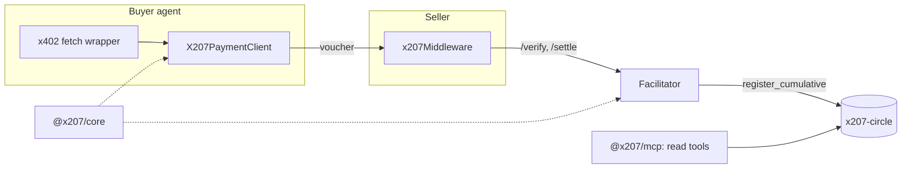

# x207 SDK

TypeScript packages that let an x402 agent pay and sell in a clearing circle: the x402 `batch-settlement` binding on the network `x207:<circleId>`, plus a reference facilitator, an MCP server and test vectors. Part of [x207](https://github.com/x207-labs/x207).

## Its role in x207

The SDK is how agents meet the [contract](https://github.com/x207-labs/contracts) without knowing NEAR. A buyer wraps `fetch` once and pays with signed vouchers; a seller adds one middleware and its `402` answer offers the voucher entry next to `exact`; the facilitator verifies vouchers and registers them on chain. `spec/` holds the voucher format and test vectors that the TypeScript and Rust CI share.

| Folder | Package | Contents |
| --- | --- | --- |
| `packages/core/` | `@x207/core` (0.0.2 on npm) | Voucher types and signing, client for the `x207-circle` contract, NEP-297 event parser, `onboardMember` |
| `packages/scheme/` | `@x207/scheme` (0.0.2 on npm) | x402 binding per role: `client/`, `server/`, `facilitator/` |
| `packages/mcp/` | `@x207/mcp` (0.0.6 on npm, bin `x207-mcp`) | MCP server: read tools by default, signs nothing |
| `apps/facilitator/` | `@x207/facilitator` | Reference facilitator: `/verify`, `/settle`, `/supported` |
| `spec/` | | `scheme_batch_settlement_x207.md` and `test-vectors/` |
| `examples/` | | `buyer`, `seller`, `mcp-paid-tool`, `python-buyer` |



## Try it

Ask an AI client about the live testnet circle through the MCP server, with no key (needs Node 22.22.2 or newer):

```bash
X207_CIRCLE_CONTRACT=x207-v013.testnet X207_CIRCLE_ID=agents-main \
X207_BACKEND_URL=https://x207.boxd.sh npx -y @x207/mcp
```

This starts a stdio server for an MCP client, so it waits for input. Configuration for Claude Desktop and Cursor: [docs in the umbrella](https://github.com/x207-labs/x207/blob/main/docs/mcp.md). To pay as a buyer:

```bash
npm install @x207/core @x207/scheme @x402/fetch
```

The snippet is ESM (top-level `await`): put `"type": "module"` in your `package.json`, or save it as a `.mts` file.

```ts
import { wrapFetchWithPayment } from "@x402/fetch";
import { X207PaymentClient, headroomFromRpc } from "@x207/scheme";

const secretKey = process.env.X207_VOUCHER_KEY as `ed25519:${string}`; // the voucher key, see below
const client = new X207PaymentClient({ payer: "agent.near", secretKey, headroom: headroomFromRpc({}) });
const paidFetch = wrapFetchWithPayment(fetch, client);
const response = await paidFetch("https://seller.example/api/summarize");
```

`secretKey` is the voucher key: one ed25519 key used only for vouchers, never a NEAR access key ([Voucher key security](docs/voucher-key-security.md)). `X207PaymentClient` registers `x207:*` and falls back to the other entry of the `402` answer (normally `exact`) when headroom runs out. A 200 response carries the header `PAYMENT-RESPONSE`; `extensions.x207.registration` is `pending`, `retrying` or `registered`.

**Already have an `x402Client` for `@x402/fetch`?** Add x207 with one `register` call (the real API of `@x402/core` 2.29, same in 2.30: `register(network, schemeClient)`; the network is `x207:<circleId>`, or `x207:*` for every circle). It does not fall back to `exact` and does not check headroom, which `X207PaymentClient` above does:

```ts
import { x402Client } from "@x402/core/client";
import { X207SchemeClient } from "@x207/scheme";

const client = new x402Client().register("x207:agents-main", new X207SchemeClient({ payer: "agent.near", secretKey }));
```

Tested in [`packages/scheme/test/readme-register.test.ts`](packages/scheme/test/readme-register.test.ts) (TC-UM-185-01): a fake seller answers `402` with the x207 entry, and `wrapFetchWithPayment(fetch, client)` retries with a signed voucher.

### One 402, two kinds of buyer (SD-093)

A seller can offer the voucher to circle members and `exact` USDC on Base Sepolia (`eip155:84532`, testnet token, no real funds) to EVM buyers outside the circle, in the same `402`. The `402` then lists `batch-settlement@x207:<circleId>`, `exact@near:mainnet` and `exact@eip155:84532`. Seller ([`examples/seller`](examples/seller)):

```ts
const app = createSeller({
  facilitatorUrl: "https://facilitator.example", // x207 facilitator: vouchers
  circleId: "agents-main",
  payTo: "seller.near",
  baseSepolia: { payTo: "0xYourSellerAddress" }, // exact on Base Sepolia, settled by the public x402 testnet facilitator (https://x402.org/facilitator)
});
```

Under the hood this is `x207Middleware({ …, alsoAccept: [{ network: "eip155:84532", asset, payTo, facilitatorUrl, extra }] })`: a payment that picks the extra entry is verified and settled at that facilitator, never at the x207 one. Buyer outside the circle (needs `@x402/evm`, a test key from your own wallet, kept out of the repo):

```ts
import { x402Client, wrapFetchWithPayment } from "@x402/fetch";
import { ExactEvmScheme } from "@x402/evm/exact/client";
import { privateKeyToAccount } from "viem/accounts";

const client = new x402Client().register("eip155:*", new ExactEvmScheme(privateKeyToAccount(process.env.EVM_TEST_KEY as `0x${string}`)));
const response = await wrapFetchWithPayment(fetch, client)("https://seller.example/api/summarize");
```

A circle member registers the voucher scheme next to it. `X207PaymentClient` is an `x402Client` that already registers `x207:*`; other schemes are added with `register`, and it prefers the voucher while headroom lasts:

```ts
const client = new X207PaymentClient({ payer: "agent.near", secretKey, headroom: headroomFromRpc({}) });
client.register("eip155:*", new ExactEvmScheme(account)); // optional fallback in USDC
// the same as x402Client.register(`x207:${circleId}`, …) for a client built by hand
```

Run the seller with `BASE_SEPOLIA_PAY_TO=0x… npm run start -w @x207/example-seller`. The test `examples/seller/test/seller.base-sepolia.test.ts` runs both buyers locally with a mock facilitator and no keys. `seller.x402-evm.test.ts` (SD-096) does the same with the real `ExactEvmScheme` of `@x402/evm` 2.29.0 as buyer and the real `ExactEvmScheme` facilitator as verifier (a fresh key per run, chain reads stubbed): the payload passes structure, EIP-712 signature and time checks, and a payload changed after signing is refused with `invalid_exact_evm_signature`. The same check passes with `@x402/evm` 2.30.0.

Joining a circle (`onboardMember`: voucher key, `join`, stake, wait for `active`) is in the [quickstart](https://github.com/x207-labs/x207/blob/main/docs/quickstart.md). Selling: [docs/seller-quickstart.md](docs/seller-quickstart.md). Full tested examples: [`examples/buyer`](examples/buyer), [`examples/seller`](examples/seller).

### Overspend across sellers: `settleMode: "register-first"` (SD-121)

**The gap.** A buyer can sign vouchers to many sellers up to its limit. The headroom check of a facilitator only sees the vouchers that facilitator holds, so with two sellers behind two facilitators the buyer can sign vouchers that are each valid but above the limit together. The contract is first come, first served: it registers the first voucher and refuses the late one with `ERR_INSUFFICIENT_CREDIT`. In the default mode (`verify-first`: `/verify`, handler, `/settle`) the seller has served on the word of its facilitator before the chain is asked, so the seller whose voucher is late has served and cannot be paid.

**The mitigation.** Pass `settleMode: "register-first"` and a `registerVoucher` function. The seller then registers the voucher on-chain first and runs the handler only if the contract accepts it; a refusal answers `402` (`errorReason: "insufficient_credit"`, the contract code in `extensions.x207.contractCode`) and the handler does not run. `registerVoucher` is permissionless, so the seller sends it from its own account:

```ts
import { buildRegisterVoucherCall, registerRefusal } from "@x207/core";

const registerVoucher: RegisterVoucherFn = async ({ voucher, signature }) => {
  try {
    await sellerAccount.call(buildRegisterVoucherCall({ circleContract: "x207-circle.near", voucher, signature }));
    return { ok: true };
  } catch (error) {
    const refusal = registerRefusal(error); // { ok: false, reason: "ERR_…" } for a contract refusal
    if (refusal) return refusal;
    throw error; // RPC or key problem: the middleware answers 503 with Retry-After
  }
};
app.use(x207Middleware({ …, settleMode: "register-first", registerVoucher }));
```

**The trade-off.** One on-chain call (about 2 seconds) runs before every response, and the facilitator `/settle` is skipped for that request because the voucher is already registered. The default stays `verify-first` and is unchanged.

**What stays open.**
- If the handler fails after the voucher is registered, the buyer is still charged (the response is passed through, there is no refund path).
- It covers the x207 entry only: `exact` and other `alsoAccept` entries, and vouchers with a `bundleId`, are not registered by the middleware.
- The voucher `seq` must be the last registered `seq` + 1 (`register_voucher` demo mode); a seller that serves many requests in parallel for one buyer needs to order them.
- A seller with its own guard in front of the middleware is not helped by the option; the check is the on-chain call itself.
- The facilitator is not asked about headroom across sellers; only the chain decides.

Evidence: 9 unit tests (`packages/scheme/test/register-first.test.ts`), one near-sandbox test with the real contract (`register-first.sandbox.test.ts`, two sellers, three facilitators, mock facilitators), and the testnet run `contracts/scripts/ct132-overspend-demo.mjs` (CT-132) on circle 0.0.18, which records the accepted and the refused `register_voucher` transaction hashes in `contracts/docs/testnet-epochs/ct132-overspend-run.json`.

## Develop and test

Needs Node ≥ 22.22.2 and npm 11 (the lockfiles are made with it; `package.json` enforces only the Node version). All dependencies are pinned exactly.

```bash
npm install
npm run build
npm test                # unit tests
npm run test:sandbox    # needs a near-sandbox binary and the contract wasm (../contracts/target/near/*.wasm)
npm run conformance     # suite for other implementations of the binding
```

The sandbox binary is looked up in `X207_SANDBOX_BIN`, or in the build output of the `contracts` repository after `cargo test` has run once. Copy `.env.example` to `.env` for the facilitator; secrets live only in `.env`, which is not committed.

## Documents

- [Costs: when there is an on-chain transaction](docs/costs.md) · [FAQ for agent builders](docs/faq-agent-builders.md)
- [`epoch_length` and the wait for payment](docs/epoch-length.md) · [Payment guarantees for sellers](docs/seller-guarantees.md)
- [Voucher key security](docs/voucher-key-security.md)
- [Proposal to the x402 Foundation (local draft, not sent)](docs/x402-foundation/README.md)
- [Conformance suite](conformance/README.md)

## Back to x207

Overview, live demo links and the claims map: [x207-labs/x207](https://github.com/x207-labs/x207).

## License

Apache-2.0
